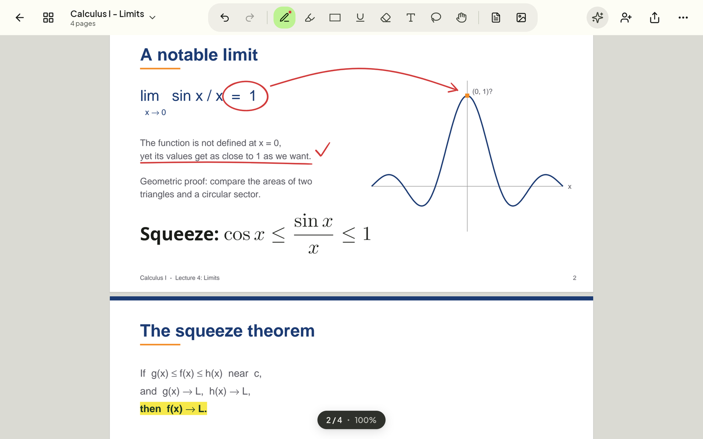
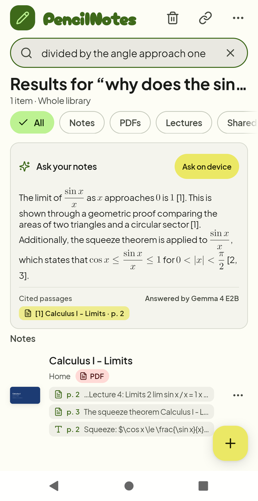
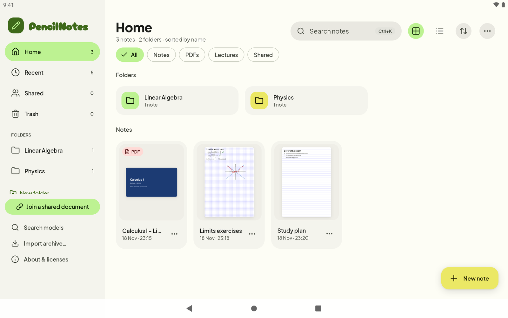

# Pageboard

[](https://github.com/valerioisufi/pageboard-kmp/actions/workflows/check.yml)
[](https://kotlinlang.org)

[](LICENSE)

**Kotlin Multiplatform libraries for drawing, handwriting and note-taking** on Android, iOS and the
desktop (JVM), and **PencilNotes**, the note-taking application built on them.

<p align="center">
  
  
</p>

* A canvas editor for the stylus: Google Ink strokes, text boxes with Markdown, code and LaTeX,
  images, PDF pages whose text can be selected and marked.
* A library of notes with folders, search by words and by meaning on the device, export to PDF and
  to archives.
* Sync between devices, end-to-end encrypted, on the local network or over the internet (iroh).
* A lecture assistant that records a lecture and suggests what the notes are missing, with local
  models or Gemini.

## PencilNotes

PencilNotes is a note app for students who write with a pen: the slides of a lecture imported as
PDFs, notes in ink and formulas, everything kept on the device.

<p align="center"></p>

* **Android**: [Google Play](https://play.google.com/store/apps/details?id=com.studiomath.pencilnotes).
* **Desktop and iOS**: built from the sources for now (see [Building](#building)).
* [Privacy policy](docs/privacy.md).

## The libraries

Each module is published on Maven Central as `io.github.valerioisufi:<module>`; an application
declares the ones it uses and gets nothing else. The optional engines (PDF, formulas, native ink)
are given by the application, and a feature degrades when its engine is missing.

```kotlin
dependencies {
    implementation(platform("io.github.valerioisufi:pageboard-bom:0.1.0")) // every library at one version
    implementation("io.github.valerioisufi:pageboard-explorer")   // the library and the editor
    implementation("io.github.valerioisufi:pageboard-store-room") // the notes in SQLite
    implementation("io.github.valerioisufi:pageboard-pdf")        // PDF pages, with PDFium
    implementation("io.github.valerioisufi:pageboard-latex")      // formulas, with MicroTeX
}
```

Until 0.1.0 is released, `./gradlew publishToMavenLocal` publishes `0.1.0-SNAPSHOT` to the local
repository. A 0.x version is experimental: the public API is recorded and every change of it is
written in the [changelog](CHANGELOG.md), but a minor version may break it.

A minimal application is a theme around `DocumentLibrary`:

```kotlin
object MyNotes {
    val documents by lazy { OpenDocuments(RoomDocumentStore(createPageboardDatabase(), InkStrokeModeller)) }
    val sessions = EditorSessions()
}

@Composable
fun App() {
    PageboardTheme {
        DocumentLibrary(title = { Text("My Notes") }, documents = MyNotes.documents, sessions = MyNotes.sessions, modifier = Modifier.fillMaxSize())
    }
}

// On the desktop the application names its data directory once, before anything reads it
fun main() {
    PageboardDesktop.init(PageboardDesktop.applicationDataDirectory("My Notes"))
    application { Window(onCloseRequest = ::exitApplication, title = "My Notes") { App() } }
}
```

On Android the application gives its context first, once (`PageboardAndroid.init(applicationContext)`
in `Application.onCreate`); iOS needs nothing, but an iOS application with `pageboard-pdf` embeds
the PDFium framework of the release (see the page of [pageboard-pdf](pageboard-pdf/Module.md)).

| Area | Modules |
|---|---|
| Document and editor | `pageboard-model`, `-ink`, `-canvas`, `-ui`, `-session`, `-html` |
| Storage | `pageboard-store`, `-store-room`, `-store-testing` |
| Library | `pageboard-explorer` |
| Engines | `pageboard-pdf` (PDFium), `-latex` (MicroTeX) |
| Sync (experimental, `@ExperimentalSyncApi`) | `pageboard-sync-protocol`, `-sync`, `-sync-lan`, `-sync-iroh`, `-sync-ui` |
| Search and local models | `pageboard-search`, `-search-ui`, `-ml`, `-ml-litert` |
| Handwriting recognition | `pageboard-handwriting`, `-handwriting-mlkit`, `-handwriting-pencilkit`, `-handwriting-windows`, `-handwriting-ui` |
| Lecture assistant | `pageboard-lecture`, `-lecture-ui`, `-lecture-testing` |
| Export | `pageboard-export`, `-export-ui` |
| External models | `pageboard-agent`, `-agent-ui` |

Every module, the features of the editor and how the native libraries are built are described in
the [reference](docs/reference.md); `./gradlew :dokkaGenerate` writes the API documentation in
`build/dokka/html`. The [sample](sample) is the smallest application on the libraries.

## Building

JDK 21 and the Android SDK (`sdk.dir` in `local.properties`); the Rust toolchain (rustup) for the
iroh bridge. Gradle builds the native libraries on demand.

```bash
./gradlew :pencilnotes-desktop:run           # PencilNotes on the desktop
./gradlew :pencilnotes-android:assembleDebug # PencilNotes on Android
./gradlew jvmTest checkKotlinAbi             # the tests and the recorded API
```

iOS: open `pencilnotes/iosApp` in Xcode. More in the [reference](docs/reference.md#running-tests).

## Contributing

Issues and pull requests are welcome: read [CONTRIBUTING.md](CONTRIBUTING.md) first. Report a
vulnerability privately, as [SECURITY.md](SECURITY.md) says.

## License

The code is under the [MIT License](LICENSE). The name **PencilNotes** and its icon are not: see
[pencilnotes/TRADEMARK.md](pencilnotes/TRADEMARK.md).

### Third-party libraries

Pageboard builds on these open-source projects:
* **[Google Ink](https://github.com/google/ink)** ([Apache 2.0](./native/ink/LICENSE)) - Freehand stroke generation and geometry modeling.
* **[Abseil C++](https://github.com/abseil/abseil-cpp)** ([Apache 2.0](./native/external/abseil-cpp/LICENSE)) - C++ standard library extensions used by Google Ink.
* **[libtess2](https://github.com/memononen/libtess2)** ([SGI Free Software License B](./native/external/libtess2/LICENSE.txt)) - Polygon tessellation used by Google Ink.
* **[PDFium](https://pdfium.googlesource.com/pdfium)** ([BSD 3-Clause](./native/pdfium/licenses/pdfium.txt)) & **[pdfium-binaries](https://github.com/bblanchon/pdfium-binaries)** ([MIT](./native/pdfium/LICENSE)) - PDF rendering engine for Desktop JVM, Android and iOS.
* **[The FreeType Project](https://www.freetype.org)** ([FTL](./native/pdfium/licenses/freetype.txt)) - *Portions of this software are copyright © 1996-2024 The FreeType Project (www.freetype.org). All rights reserved.*
* **[MicroTeX](https://github.com/NanoMichael/MicroTeX)** ([MIT](./native/tex/README.md)) - Dynamic LaTeX mathematical formula rendering.
* **[Opus](https://opus-codec.org)** ([BSD 3-Clause](./THIRD_PARTY_LICENSES.md#bsd-3-clause-license-opus)) - Compression of the lecture recordings.
* **[VisualOn AAC encoder](https://sourceforge.net/projects/opencore-amr/files/vo-aacenc/)** ([Apache 2.0](./THIRD_PARTY_LICENSES.md#apache-license-version-20)) - AAC encoding of the exported recordings.
* **[Plus Jakarta Sans Font](https://github.com/tokotype/PlusJakartaSans)** ([SIL OFL 1.1](./pageboard-ui/PLUS_JAKARTA_SANS_OFL_LICENSE.txt)) - Application typography.
* **[Lucide](https://lucide.dev)** ([ISC](./THIRD_PARTY_LICENSES.md#isc-license-lucide)) - Icons of the interface.
* **[Cherry Bomb One Font](https://github.com/satsuyako/CherryBomb)** ([SIL OFL 1.1](./pencilnotes/shared/CHERRY_BOMB_ONE_OFL_LICENSE.txt)) - PencilNotes wordmark typography.
* **Computer Modern, Doublestroke & AMS Fonts** ([Knuth / dsrom / OFL](./pageboard-latex/src/commonMain/composeResources/files/tex/fonts/licences/)) - LaTeX mathematical typography.

For complete license texts, copyright notices, and disclaimers, please see [THIRD_PARTY_LICENSES.md](./THIRD_PARTY_LICENSES.md).
